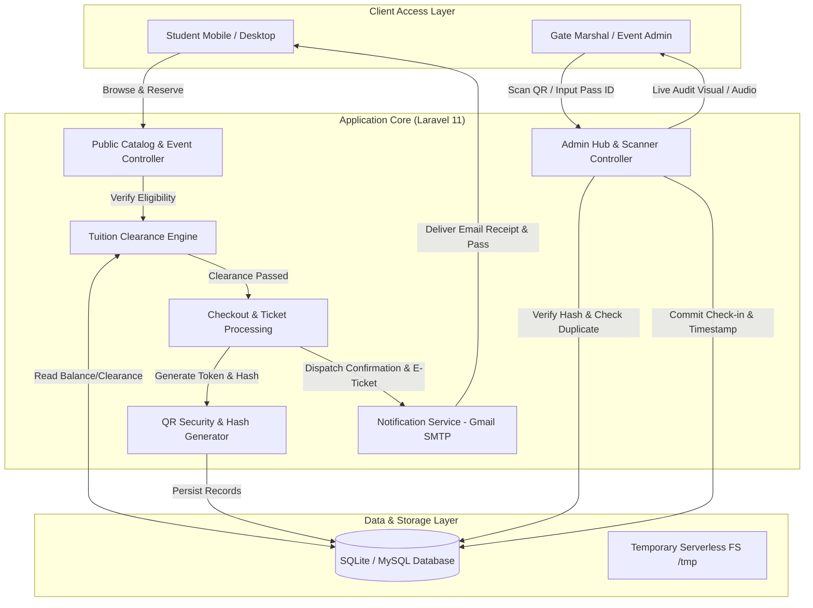
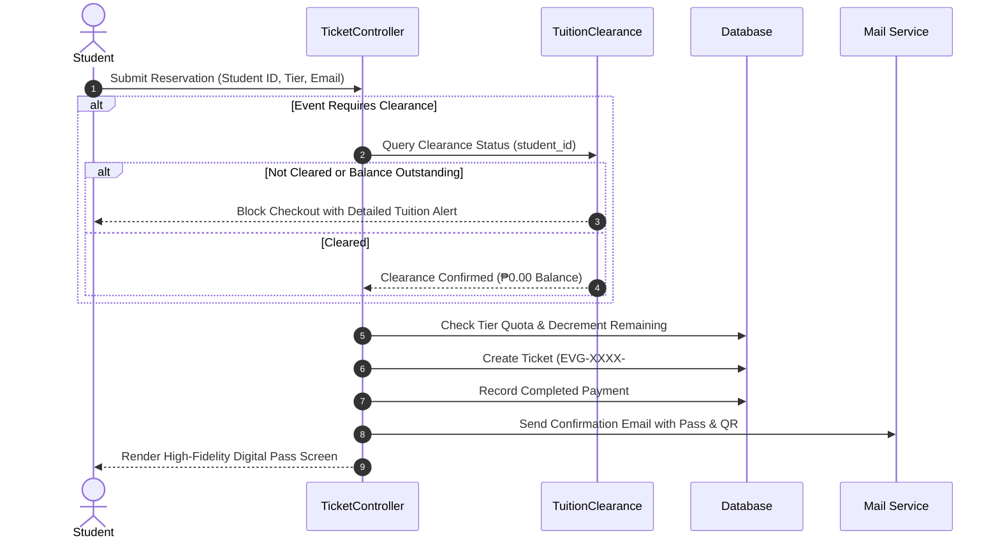
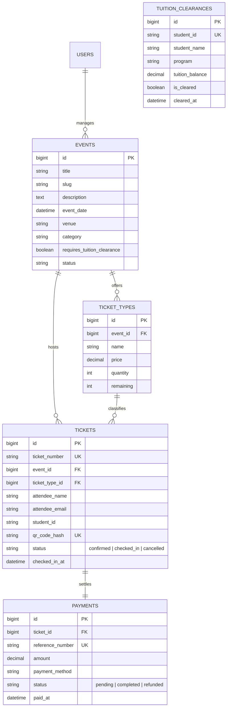

# EnvergaPass — Executive Architecture & System Documentation
> **Manuel S. Enverga University Foundation (MSEUF) Digital Event Ticketing & Verification Ecosystem**

---

## 1. Executive Summary

**EnvergaPass** is an enterprise-grade digital ticketing, event management, and access verification web platform engineered for the **Manuel S. Enverga University Foundation (MSEUF)**. 

The system transitions traditional campus paper passes and manual ticket validation into an automated, fraud-resistant digital workflow. It bridges **institutional student financial clearance**, **real-time cryptographic QR pass issuance**, **automated transactional ticketing notifications via SMTP**, and **live optical gate scanning** for event marshals and campus administrators.

---

## 2. Key Objectives & Business Value

```
┌────────────────────────────────────────────────────────────────────────┐
│                        CORE VALUE DRIVERS                              │
├───────────────────┬──────────────────────┬─────────────────────────────┤
│ 1. Zero Paper     │ 2. Financial Gate    │ 3. Fraud-Proof Access       │
│ Eco-friendly &    │ Automatic validation │ SHA-256 encrypted QR tokens │
│ instant digital   │ with Accounting's    │ preventing pass duplication │
│ ticket delivery   │ clearance database   │ and unauthorized entries    │
└───────────────────┴──────────────────────┴─────────────────────────────┘
```

- **Seamless Student Experience**: Students explore campus events, check tuition clearance status, reserve tiered tickets, and obtain verifiable digital passes directly on mobile devices.
- **Tuition Clearance Enforcement**: Restricts event passes exclusively to financially cleared students for designated institutional university gatherings.
- **Sub-Second Gate Verification**: Admin QR scanning interface equipped with live camera stream decoding, instant sound and visual feedback, duplicate scan prevention, and manual fallbacks.
- **Operational Intelligence**: Real-time admin dashboard tracking ticket sales, active attendance, check-in velocity, and revenue aggregation.

---

## 3. High-Level System Architecture

The project is built upon **Laravel 11 / PHP 8.2+**, styled with **Tailwind CSS**, energized by **Vanilla JS & HTML5 QR Engine**, and architected to support both traditional on-premise LAMP/LEMP stacks and modern **Vercel Serverless Function** execution.



---

## 4. End-to-End Workflow Breakdown

### Phase 1: Event Discovery & Selection
1. **Public Catalog**: Attendees view active, upcoming, or featured university events (e.g., University Foundation Week, College Concerts, Departmental Seminars).
2. **Tiered Allocations**: Real-time display of ticket tiers (e.g., *General Admission*, *VIP Pass*, *Student Delegate*) along with live seat/quota counters.

### Phase 2: Clearance & Reservation Logic


### Phase 3: Cryptographic Pass Generation
* **Human-Readable ID**: Formatted as `EVG-[4 RANDOM UPPERCASE]-[4 DIGIT RANDOM]` (e.g., `EVG-XK9P-8472`).
* **Cryptographic Token**:
  $$\text{QR Hash} = \text{SHA-256}(\text{ticket\_number} \parallel \text{"|"} \parallel \text{student\_id})$$
* **Security Resilience**: Prevents tampering; students cannot spoof someone else’s ticket number since the scanned hash links directly to the authenticated database ledger.

### Phase 4: Gate Check-in & Scanner Protocol
1. **Camera Feed Scanning**: Gate marshals open `/admin/scanner` on any camera-equipped smartphone, tablet, or terminal.
2. **Instant Verification**:
   - **Green (Valid)**: Ticket matched, status marked `checked_in`, timestamp stamped, confirmation chime triggers.
   - **Yellow/Red (Already Used)**: Alert flags ticket was already scanned at `[Timestamp]` to prevent double-entry fraud.
   - **Red (Invalid / Mismatched)**: Hash does not exist or event filter mismatch.

---

## 5. Database Schema & Data Dictionary



---

## 6. Serverless Cloud Architecture (`api/index.php`)

To support zero-maintenance cloud hosting on **Vercel Serverless Functions**:

1. **Ephemeral `/tmp` Filesystem Bootstrapping**:
   - Vercel functions execute in a read-only container except for `/tmp`.
   - `api/index.php` dynamically creates storage folders (`/tmp/storage/framework/views`, `/tmp/storage/logs`).
   - Copies the bundled SQLite seed database to `/tmp/database.sqlite` on container spin-up.
2. **Runtime Configuration Bridge**:
   - Dynamically remaps framework cache and session configurations:
     - `VIEW_COMPILED_PATH` $\rightarrow$ `/tmp/storage/framework/views`
     - `SESSION_DRIVER` $\rightarrow$ `cookie`
     - `LOG_CHANNEL` $\rightarrow$ `stderr`
     - `MAIL_MAILER` $\rightarrow$ Gmail SMTP

---

## 7. Presentation Pitch & Slide Outline (Ready-to-Present)

### Slide 1: Title & Hook
- **Header**: EnvergaPass: The Next-Gen Campus Event Access Ecosystem
- **Presenter**: Engineering & Development Team
- **Tagline**: *"Eliminating Paper, Preventing Gate Fraud, Automating Campus Event Clearance."*

### Slide 2: The Problems We Solved
- **Long Lines & Gate Congestion**: Manual name lookups cause entry bottlenecks.
- **Tuition Accountability**: Difficulty verifying whether students attending gala/institutional events are in good financial standing.
- **Ticket Duplication**: Screenshots of barcode/paper passes easily shared with unauthorized individuals.

### Slide 3: The Solution
- Self-service portal with **live tuition balance validation**.
- Instant SHA-256 digital pass with QR code delivered to screen & email.
- Mobile browser-based **gate scanner** requiring zero app store downloads.

### Slide 4: Live Demonstration Walkthrough
1. **Student Journey**: Select Event $\rightarrow$ Enter Student ID $\rightarrow$ Clearance Auto-Check $\rightarrow$ Instant E-Pass Issued.
2. **Marshal Journey**: Admin Login $\rightarrow$ Access Scanner $\rightarrow$ Real-time Camera Detection $\rightarrow$ Instant Verification Sound & Visual Audit.
3. **Analytics Dashboard**: Real-time sales metrics, revenue, check-in percentages.

### Slide 5: Tech Stack & Security Highlights
- **Laravel 11 Enterprise Framework**: Robust MVC, Eloquent ORM, secure CSRF & SQL injection protections.
- **Cryptographic Access Tokens**: SHA-256 one-way hashing for QR security.
- **Serverless Cloud Ready**: Frictionless global deployment with zero server maintenance overhead.

---

## 8. Summary Checklist for Presentation

| Demonstration Step | Key Element to Highlight | Expected Outcome |
| :--- | :--- | :--- |
| **1. Browse Events** | Clean UI & Tiered Pricing | Shows modern student experience |
| **2. Test Uncleared Student** | Try student with outstanding balance | Displays clearance rejection notice |
| **3. Test Cleared Student** | Valid student check | Generates `EVG-XXXX-####` pass + QR |
| **4. Email Receipt** | Inbox check | Formatted confirmation e-ticket |
| **5. Gate Scan** | Point camera at generated QR | Audio chime + Green Verified banner |
| **6. Repeat Scan** | Point camera at the same QR again | Warning: *"Already Checked-in at [Time]"* |
| **7. Admin Metrics** | Refresh `/admin/dashboard` | Live count increments instantly |

---
*Created for Manuel S. Enverga University Foundation — EnvergaPass System.*

